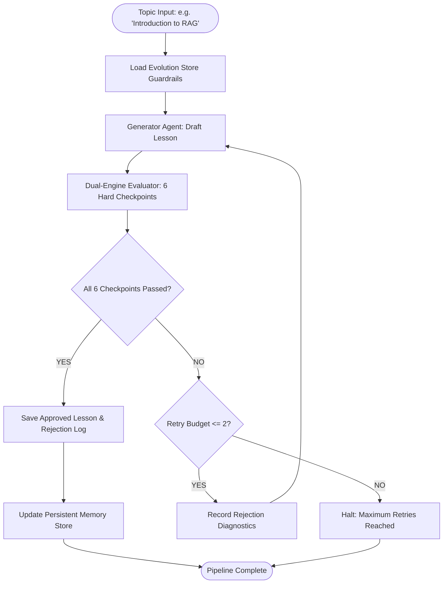

# Self-Evaluating Lesson Content Generator

An agentic content generation and quality-assurance system for technical education. Built for the GenAI Engineer - Content Systems assessment.

Author: Yaswanth  
Topic: Introduction to RAG (Retrieval-Augmented Generation)  
Target Audience: 12th-grade graduate from India with regional-medium education, limited English vocabulary, and zero AI background.

---

## Overview

Generating educational content for beginners requires more than a single prompt. LLMs frequently hallucinate, slip in complex jargon, or assume mathematical background. For a regional-medium 12th-grade student, introducing terms like "vector embeddings" or "cosine similarity" creates an immediate barrier to learning.

This project implements an autonomous quality loop:
1. **Generator** drafts a lesson using relatable analogies (e.g., open-book board exams, Kirana store ledgers) and simple vocabulary.
2. **Evaluator** tests the draft against 6 hard checkpoints using a combination of deterministic code and LLM-as-a-judge reasoning.
3. If any check fails, the draft is rejected with **zero partial credit**. Failure reasons and prescriptive fixes are fed back to the generator.
4. The cycle repeats until all checks pass, with a strict termination cap (`MAX_RETRIES = 2`).
5. A persistent memory store logs failure patterns across runs and dynamically injects learned guardrails into future prompts.

---

## System Architecture



---

## Evaluation Rubric (Zero Partial Credit)

The evaluator uses a dual-engine design. Deterministic Python functions handle lexical and structural checks to prevent evaluator hallucination, while an LLM judge evaluates conceptual grounding and teaching flow.

| Checkpoint | Engine | What It Tests | Pass Condition |
| :--- | :--- | :--- | :--- |
| `ACCURACY_AND_GROUNDING` | LLM Judge | Technical accuracy | Correctly models retrieval, prompt injection, and generation without confusing RAG with fine-tuning. |
| `BEGINNER_VOCABULARY` | Python Code | Readability | Flesch-Kincaid Grade $\le 8.5$, average sentence length $\le 20$ words. |
| `ANALOGY_AND_EXAMPLE` | LLM Judge | Everyday grounding | Uses an Indian everyday analogy (open-book exam, library notes, Kirana ledger) carried consistently. |
| `NO_UNEXPLAINED_JARGON` | Python Regex | Clarity | Zero unexplained academic terms (e.g. latent space, embeddings, cosine distance). |
| `KEY_POINTS_COVERAGE` | Python Code | Completeness | Non-empty sections for What it is, Why it matters, and How it works. |
| `COHERENT_TEACHING_FLOW` | LLM Judge | Pedagogical flow | Logical progression: Hook ➔ Problem ➔ Definition ➔ Mechanics ➔ Takeaway. |

If any single check fails, the draft is marked as rejected. No partial scores are awarded.

---

## Design Choices & Trade-Offs

* **LangGraph over Linear Chains:** A quality-control loop is cyclical, not linear. LangGraph gives explicit state transitions, conditional edge routing, and a guaranteed retry ceiling.
* **Deterministic Rules for Readability:** LLMs are unreliable at counting syllables or sentence lengths. Calculating Flesch-Kincaid scores and scanning forbidden jargon with regex ensures deterministic enforcement.
* **Persistent Evolution Memory:** Stored in `memory/evolution_store.json`. When specific failure modes recur across runs, the system clusters them and synthesizes new prompt rules (e.g., enforcing shorter sentences or defining technical acronyms immediately).
* **Guaranteed Loop Termination:** Hard retry cap of 2 iterations ensures the pipeline never hangs in an infinite cycle.

---

## Project Structure

```
├── run_pipeline.py                 # CLI production entrypoint
├── test_deliberate_error.py        # Verification script: catches injected errors
├── app.py                          # Streamlit dashboard
├── requirements.txt                # Dependencies
├── .env.example                    # Environment template
│
├── src/
│   ├── config.py                   # Global configuration & target persona
│   ├── schemas.py                  # Pydantic v2 data models
│   ├── generator/                  # Lesson generation & prompt templates
│   ├── evaluator/                  # Deterministic checks & LLM judge
│   ├── memory/                     # Self-evolving cross-run memory
│   ├── graph/                      # LangGraph state machine & workflow
│   └── utils/                      # LLM client & Rich console helpers
│
├── tests/                          # 8 automated unit & integration tests
├── logs/                           # Rejection log audit trail
└── memory/                         # Persistent evolution store
```

---

## Setup & Running

### 1. Installation
```bash
git clone <your-repo-url>
cd Yaswanth_project
python3 -m venv venv
source venv/bin/activate
pip install -r requirements.txt
```

### 2. Environment Configuration
```bash
cp .env.example .env
# Add your API key (OpenRouter, OpenAI, or Anthropic):
# OPENROUTER_API_KEY=sk-or-v1-...
```

### 3. Run the Pipeline
```bash
# Production run
python3 run_pipeline.py --topic "Introduction to RAG"

# Offline mock mode (no API key required)
python3 run_pipeline.py --topic "Introduction to RAG" --mock
```

### 4. Run the Deliberate Error Demonstration
```bash
python3 test_deliberate_error.py
```
This forces Draft 1 to include PhD-level jargon (*"1536-dimensional latent space", "cosine similarity"*). The evaluator flags the jargon, logs the rejection, and regenerates a clean draft that passes all checkpoints.

### 5. Launch the Streamlit Dashboard
```bash
streamlit run app.py
```

### 6. Run the Test Suite
```bash
python3 -m unittest discover -s tests -v
```
Runs all 8 unit and integration tests covering syllables, jargon detection, readability scoring, zero partial credit, LangGraph cycles, and memory evolution.
