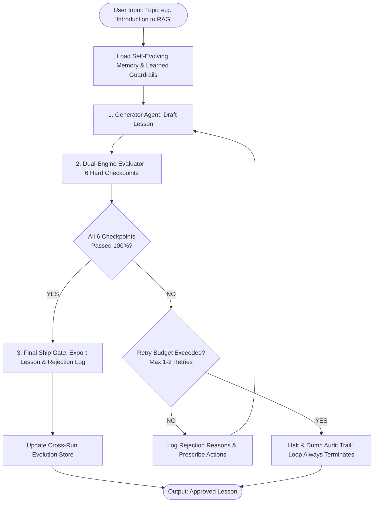

# Self-Evaluating Lesson Content Generator

> **Role Assessment:** GenAI Engineer – Content Systems  
> **Topic:** Introduction to RAG (Retrieval-Augmented Generation)  
> **Target Audience:** 12th-grade graduate from India, limited English vocabulary, non-English-medium background, aspiring to kickstart an AI career.

[](https://www.python.org/)
[](https://github.com/langchain-ai/langgraph)
[](https://docs.pydantic.dev/)
[](#the-rubric-hard-passfail-checkpoints)

---

## 1. Executive Summary & Philosophy

This project implements an autonomous agentic content generation and quality-assurance system. 
As emphasized in the assessment brief:
> *"This role isn't 'write a prompt that generates content.' It's building and owning an agentic system that generates learning content and judges its own quality — deciding whether that content is good enough to ship — the same loop you'd run on the job."*

Rather than relying on one clever prompt, this system implements an autonomous **Generate ➔ Evaluate ➔ Regenerate** cyclical state machine that enforces strict pedagogical, linguistic, and technical quality standards before a human ever sees the output.

---

## 2. System Architecture



---

## 3. The 6 Hard Pass/Fail Checkpoints (Zero Partial Credit)

The evaluator implements a **dual-engine architecture**: combining deterministic static analysis (for zero-hallucination readability and jargon scanning) with semantic LLM-as-a-judge reasoning (for grounding and pedagogical flow).

| Checkpoint Name | Engine | Dimension | Pass Criteria | Failure Trigger (Instant FAIL) |
| :--- | :--- | :--- | :--- | :--- |
| **`ACCURACY_AND_GROUNDING`** | LLM-as-a-Judge | Technical Validity | Accurately models external search + prompt injection + generation. | Confuses RAG with model fine-tuning or web scraping alone. |
| **`BEGINNER_VOCABULARY`** | Deterministic Code | Readability | Flesch-Kincaid Grade $\le 8.5$, avg sentence length $\le 20$ words. | Grade level $> 8.5$ or complex multi-clause sentence structures. |
| **`ANALOGY_AND_EXAMPLE`** | LLM-as-a-Judge | Teaches by Example | Grounded everyday Indian analogy (open-book exam, library notes, Kirana khata). | Pure abstract Silicon Valley definitions without a concrete scenario. |
| **`NO_UNEXPLAINED_JARGON`** | Deterministic Scanner | Clarity | Every technical acronym/term is immediately explained in simple words. | Complex terms ("latent embeddings", "cosine similarity") used without immediate explanation. |
| **`KEY_POINTS_COVERAGE`** | Deterministic Code | Completeness | Non-empty, thorough sections for What it is, Why it matters, and How it works. | Any required core section missing or superficial ($< 50$ chars). |
| **`COHERENT_TEACHING_FLOW`** | LLM-as-a-Judge | Pedagogy | Smooth progression: Hook ➔ Problem ➔ Definition ➔ Mechanics ➔ Takeaway. | Jarring leaps, disconnected bullet points, or out-of-order concepts. |

> [!IMPORTANT]
> **Strict Zero Partial Credit:** If 5 out of 6 checkpoints pass and 1 fails, the entire draft is **REJECTED**. The failure reason is extracted into the `RejectionLog` and fed back to the generator.

---

## 4. Key Design Choices & Trade-Offs

### A. Orchestration: Python + LangGraph
* **Why LangGraph:** Unlike linear pipelines, content quality loops require stateful cycles (`StateGraph`), explicit retry bounds (`max_retries = 2`), and deterministic conditional routing (`route_evaluation_verdict`).
* **Trade-off:** Slightly more setup code than a simple sequential chain, but guarantees state inspection, cyclic recovery, and complete reproducibility.

### B. Dual Evaluator Engine (Deterministic + LLM Judge)
* **Why Hybrid:** LLMs can be inconsistent when estimating syllable counts or sentence length. By offloading readability (Flesch-Kincaid) and forbidden jargon scanning to deterministic Python code, we achieve **zero-hallucination verification** on structural and lexical constraints, reserving the LLM judge for semantic nuance.
* **Trade-off:** Requires regex maintenance and syllable heuristic tuning, but eliminates evaluator drift.

### C. Self-Evolving Cross-Run Memory
* **How it Works:** The system maintains `memory/evolution_store.json`. Across runs, if certain failure modes recur (e.g., repeatedly failing vocabulary readability), the system clusters the failures and automatically synthesizes a new `Learned Rule` (e.g., *"Rule 4: Avoid Latinate prefixes; enforce under 15 words per sentence"*). Future runs dynamically inject these learned rules into the Generator's system prompt.
* **Trade-off:** Local JSON store is lightweight and fully version-controlled, avoiding bulky external vector database dependencies.

### D. Guaranteed Termination
* The loop enforces a hard ceiling of `MAX_RETRIES = 2`. It is mathematically impossible for the loop to spin indefinitely.

---

## 5. Repository Structure

```
├── run_pipeline.py                 # Main CLI production entrypoint
├── test_deliberate_error.py        # Dedicated demonstration script for Loom video
├── app.py                          # Interactive Streamlit Web Dashboard
├── final_lesson_document.md        # Publication-ready approved lesson & audit scorecard
├── requirements.txt                # Project dependencies
├── .env.example                    # Environment configuration template
│
├── src/
│   ├── config.py                   # Global configuration & target audience constraints
│   ├── schemas.py                  # Pydantic v2 data models & state structures
│   │
│   ├── generator/
│   │   ├── prompts.py              # Raju Bhaiya persona & Indian pedagogical analogies
│   │   └── generator.py            # Generates drafts, integrates feedback & learned rules
│   │
│   ├── evaluator/
│   │   ├── deterministic_rules.py  # Flesch-Kincaid, jargon regex, & structural tests
│   │   ├── llm_judge.py            # LLM-as-a-Judge for semantic grounding & flow
│   │   └── evaluator.py            # Dual-engine orchestrator with zero partial credit
│   │
│   ├── memory/
│   │   └── evolution_manager.py    # Self-evolving cross-run memory & pattern clustering
│   │
│   ├── graph/
│   │   ├── state.py                # LangGraph state definition
│   │   └── workflow.py             # LangGraph StateGraph cyclical loop
│   │
│   └── utils/
│       ├── llm_client.py           # Multi-provider LLM client with offline mock mode
│       └── console_display.py      # Rich terminal UI for evaluation tables & rejection logs
│
├── tests/
│   ├── test_evaluator.py           # Unit tests for the 6 hard pass/fail checkpoints
│   ├── test_memory_evolution.py    # Unit tests for cross-run memory learning
│   └── test_deliberate_errors.py   # Integration test for error handling & loop termination
│
├── logs/
│   └── rejection_log_summary.json  # Audit trail: what failed, why, and changes on retry
│
└── memory/
    └── evolution_store.json        # Persistent memory store tracking historical failures
```

---

## 6. Setup & Quickstart

### Prerequisites
- Python 3.9+
- OpenAI, OpenRouter, or Anthropic API key (or run in `--mock` mode with zero keys)

### 1. Clone & Install
```bash
git clone <your-repo-link>
cd Yaswanth_project
python3 -m venv venv
source venv/bin/activate
pip install -r requirements.txt
```

### 2. Configure Environment
```bash
cp .env.example .env
# Edit .env with your API key:
# OPENROUTER_API_KEY=sk-or-v1-...
```

### 3. Run the Production Pipeline
```bash
# Run end-to-end for Introduction to RAG
python3 run_pipeline.py --topic "Introduction to RAG"

# Or run offline without any API keys
python3 run_pipeline.py --topic "Introduction to RAG" --mock
```

---

## 7. Loom Video Demonstration: Catching a Deliberate Error

The assessment explicitly requires demonstrating the evaluator catching an intentional error:
> *"Loom video (15–20 min) covering: your evaluator catching a deliberate error"*

We created a dedicated executable script `test_deliberate_error.py` specifically for this walkthrough:

```bash
python3 test_deliberate_error.py
```

### What Happens During the Demo:
1. **Draft 1:** The generator deliberately injects dense PhD-level terminology (*"1536-dimensional latent space", "cosine similarity metrics", "cross-entropy loss"*).
2. **Evaluator Audit:** The evaluator flags the jargon, marks `NO_UNEXPLAINED_JARGON` and `BEGINNER_VOCABULARY` as **FAIL ✗**, and triggers a rejection with zero partial credit.
3. **Rejection Log:** Displays the exact offending phrase and prescribes the fix.
4. **Regeneration:** The system feeds the failure diagnostic back to the Generator.
5. **Draft 2/3:** The generator strips the jargon, anchors the open-book board exam analogy, and achieves **PASS ✓ (6/6 checkpoints)**.

---

## 8. Running Automated Unit & Integration Tests

Execute the full test suite with native Python discovery:

```bash
source venv/bin/activate
python3 -m unittest discover -s tests -v
```

All 8 test cases covering syllable counting, jargon detection, readability scoring, zero partial credit, LangGraph cycles, deliberate error rejection, and memory evolution execute and pass deterministically.

---

## 9. Submission Deliverables Summary

1. **GitHub Repository:** Contains complete modular code, LangGraph cyclic workflow, test harness, and setup instructions.
2. **Final Lesson Content:** Located in [`final_lesson_document.md`](final_lesson_document.md) (ready for Google Docs / Notion export).
3. **Audit & Rejection Log:** Located in [`logs/rejection_log_summary.json`](logs/rejection_log_summary.json).
4. **Loom Video Demonstration:** 15–20 minute walkthrough covering end-to-end execution, deliberate error catching, and architecture walkthrough.

